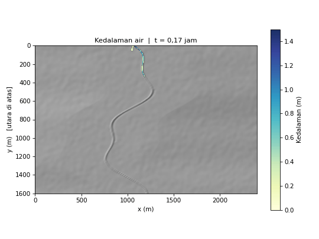
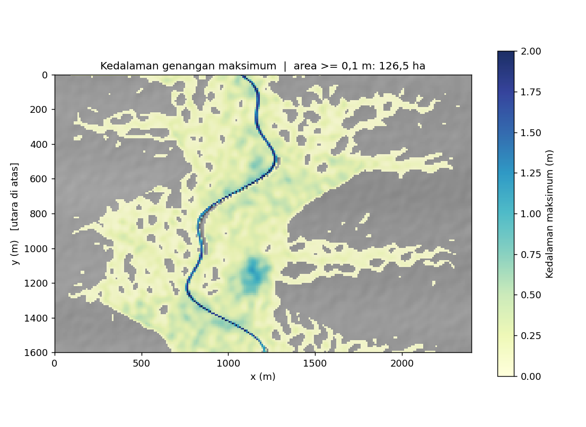
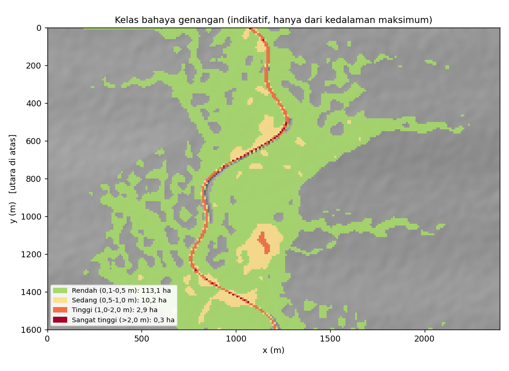

# floodsim: Prakiraan Genangan Banjir 2D Skala Kecil, Siap HPC

**Nama:** Dinda Krisnauli Pakpahan  
**NPM:** G1A023076  
**Mata Kuliah:** Deep Learning  
**Semester:** 7

---

Simulator genangan banjir 2D untuk daerah tangkapan kecil (beberapa km²) yang dikembangkan menggunakan Python dan NumPy. Model menghitung **kedalaman dan penjalaran genangan** berdasarkan curah hujan dan debit sungai di atas Digital Elevation Model (DEM). Hasil simulasi meliputi peta kedalaman maksimum, waktu tiba genangan, kelas bahaya, deret waktu, dan animasi.

Domain simulasi dapat **dibagi ke beberapa proses menggunakan MPI**, sehingga proyek ini dapat digunakan sebagai studi kasus komputasi kinerja tinggi (*High-Performance Computing* atau HPC).



| Kedalaman Maksimum | Kelas Bahaya (Indikatif) |
|---|---|
|  |  |

> **Catatan:** Gambar di atas berasal dari lembah sintetis yang didefinisikan dalam `configs/demo.toml`, bukan dari lokasi nyata. Baca bagian [Keterbatasan](#keterbatasan) sebelum menggunakan hasil simulasi sebagai dasar pengambilan keputusan.

## Fitur

- Model **inersia lokal 2D** yang termasuk dalam kelas formulasi LISFLOOD-FP, dilengkapi gesekan Manning, kondisi basah-kering, serta batas terbuka dan tertutup.
- **Kekekalan massa** melalui pembatasan fluks (*flux limiting*). Galat neraca massa pada simulasi demo sekitar `1e-15`.
- Mendukung masukan berupa DEM (`.asc`), data hujan dalam bentuk rencana atau CSV, debit sungai berupa hidrograf, serta raster Manning dan infiltrasi sebagai parameter opsional.
- **Pemrosesan paralel dengan dekomposisi domain**, menggunakan pembagian slab baris dan pertukaran halo melalui `mpi4py`. Hasil paralel diklaim identik bit-per-bit dengan hasil serial.
- Keluaran yang kompatibel dengan perangkat lunak GIS, seperti `max_depth.asc` dan `arrival_time_min.asc`, yang dapat dibuka menggunakan QGIS.
- Skrip **benchmark strong scaling** dan templat pekerjaan SLURM.
- Pengujian otomatis yang mencakup kekekalan massa, kondisi *lake-at-rest*, serta kesetaraan hasil serial dan paralel.
- Integrasi berkelanjutan (*Continuous Integration* atau CI) menggunakan GitHub Actions.

## Mulai Cepat

### Persyaratan

- Python versi 3.11 atau lebih baru.
- Git.
- NumPy dan dependensi lain yang tercantum dalam `requirements.txt`.

### Instalasi

```bash
git clone <URL-REPO-ANDA> flood-inundation-hpc
cd flood-inundation-hpc

python -m venv .venv
```

Aktifkan lingkungan virtual sesuai sistem operasi.

**Linux/macOS:**

```bash
source .venv/bin/activate
```

**Windows (PowerShell):**

```powershell
.venv\Scripts\Activate.ps1
```

Instal dependensi:

```bash
pip install -r requirements.txt
```

### Menjalankan Simulasi

**1. Uji cepat**

Simulasi ini membutuhkan waktu beberapa detik.

```bash
python -m floodsim run --config configs/smoke.toml --plot
```

**2. Demo lengkap**

Simulasi ini membutuhkan waktu sekitar dua menit pada satu inti prosesor, kemudian menghasilkan gambar dan animasi.

```bash
python -m floodsim run --config configs/demo.toml --plot
```

Hasil simulasi disimpan dalam direktori `outputs/<nama>/`.

| Berkas | Keterangan |
|---|---|
| `summary.json` | Ringkasan neraca massa, waktu komputasi, dan luas genangan berdasarkan kelas kedalaman. |
| `history.csv` | Deret waktu curah hujan, debit masuk, luas genangan, kedalaman maksimum, dan volume air. |
| `max_depth.asc` | Kedalaman maksimum setiap sel dalam meter, menggunakan format ESRI ASCII Grid. |
| `arrival_time_min.asc` | Waktu dalam menit sejak awal simulasi ketika suatu sel pertama kali tergenang dengan kedalaman lebih dari 0,1 m. |
| `arrays.npz`, `snapshots.npz` | Larik NumPy untuk analisis lanjutan dan pembuatan animasi. |
| `figures/*.png`, `flood.gif` | Peta dan grafik yang dihasilkan melalui opsi `--plot` atau perintah plotting yang tersedia. |

Contoh ringkasan hasil demo dapat dilihat pada [`assets/demo_summary.json`](assets/demo_summary.json).

## Menjalankan Simulasi Paralel

Untuk menggunakan MPI, instal `mpi4py` dan pastikan implementasi MPI, seperti OpenMPI atau MPICH, telah terpasang pada sistem.

```bash
pip install mpi4py
```

Jalankan simulasi dengan empat proses:

```bash
mpirun -n 4 python -m floodsim run --config configs/demo.toml --backend mpi --outdir outputs/mpi4
```

Untuk memverifikasi kesetaraan hasil, jalankan simulasi serial dan bandingkan hasilnya dengan simulasi MPI.

```bash
python -m floodsim run --config configs/demo.toml --outdir outputs/serial

python scripts/compare_runs.py outputs/serial outputs/mpi4
```

### Pilihan Backend

| Backend | Keterangan |
|---|---|
| `serial` | Menjalankan simulasi menggunakan satu proses. Ini merupakan pilihan default. |
| `slabs --parts N` | Membagi domain menjadi N slab dalam satu proses untuk menguji logika dekomposisi. |
| `threads --parts N` | Menggunakan N thread dengan `ThreadComm` untuk menguji mekanisme komunikasi terdistribusi. |
| `mpi` | Menggunakan satu slab untuk setiap rank MPI dan dijalankan melalui `mpirun` atau `srun`. |

### Menjalankan pada Klaster HPC

Templat pekerjaan SLURM tersedia pada berkas berikut:

- [`slurm/run_flood.sbatch`](slurm/run_flood.sbatch): menjalankan satu simulasi.
- [`slurm/scaling.sbatch`](slurm/scaling.sbatch): menjalankan pengujian scaling.

Nama partisi, modul, dan konfigurasi pekerjaan perlu disesuaikan dengan klaster HPC yang digunakan.

### Mengukur Scaling

Skrip benchmark dapat digunakan untuk mengukur kinerja simulasi dengan jumlah proses yang berbeda.

```bash
python scripts/benchmark_scaling.py \
    --config configs/demo.toml \
    --procs 1 2 4 8 \
    --launcher mpirun \
    --set terrain.ny=480 \
    --set terrain.nx=720 \
    --set run.duration_h=1.0
```

Skrip menghasilkan tabel waktu komputasi, *speedup*, efisiensi, dan throughput dalam juta pembaruan sel per detik. Hasilnya juga disimpan dalam `scaling.csv` dan `scaling.png`.

Rumus yang digunakan:

- **Speedup:** \(S(P) = T(1)/T(P)\)
- **Efisiensi:** \(E(P) = S(P)/P\)

Keterangan:

- \(P\) adalah jumlah proses.
- \(T(1)\) adalah waktu eksekusi menggunakan satu proses.
- \(T(P)\) adalah waktu eksekusi menggunakan P proses.

Tabel berikut dapat diisi menggunakan hasil pengukuran pada mesin yang digunakan.

| Jumlah Proses (P) | Waktu (detik) | Speedup | Efisiensi |
|---:|---:|---:|---:|
| 1 | — | 1,00 | 100% |
| 2 | — | — | — |
| 4 | — | — | — |
| 8 | — | — | — |

Sebagai acuan, simulasi demo berukuran 160 × 240 sel pada satu inti prosesor di lingkungan pengembangan dengan NumPy dan tanpa MPI membutuhkan waktu sekitar 117 detik, dengan throughput sekitar 4,6 juta pembaruan sel per detik. Hasil aktual dapat berbeda bergantung pada spesifikasi perangkat keras dan lingkungan eksekusi.

## Menggunakan Data Sendiri

Simulator dapat menggunakan data topografi dan parameter hidrologi dari lokasi penelitian yang diinginkan.

### 1. Digital Elevation Model (DEM)

Potong data DEM sesuai area studi, kemudian ubah menjadi grid beraturan dalam satuan meter menggunakan proyeksi UTM yang sesuai. Resolusi yang dapat digunakan sebagai titik awal adalah sekitar 5–30 meter. Selanjutnya, ekspor data ke format ASCII Grid.

Contoh konversi menggunakan GDAL:

```bash
gdalwarp -t_srs EPSG:327xx -tr 10 10 -r bilinear \
    -te xmin ymin xmax ymax dem_sumber.tif dem_utm.tif

gdal_translate -of AAIGrid dem_utm.tif dem.asc
```

Ganti `327xx` dengan kode EPSG zona UTM belahan selatan yang sesuai dengan lokasi penelitian. Sesuaikan pula koordinat batas area pada parameter `-te`.

Sumber data DEM yang dapat digunakan antara lain DEMNAS dari BIG, SRTM, ALOS AW3D30, serta data hasil survei drone atau LiDAR.

Panduan tambahan tersedia pada [`data/README.md`](data/README.md).

### 2. Data Curah Hujan

Data hujan dapat disimpan dalam berkas CSV dengan kolom:

```text
time_min,intensity_mm_h
```

Contoh berkas tersedia pada `data/contoh/hujan.csv`. Setiap baris berlaku hingga waktu pada baris berikutnya, dan data diakhiri dengan intensitas hujan sebesar nol.

### 3. Debit Sungai Masuk (Opsional)

Tentukan lokasi sel tempat debit sungai masuk dalam format `[baris, kolom]`. Baris ke-0 merepresentasikan bagian utara domain. Data debit dimasukkan dalam bentuk hidrograf.

### 4. Kekasaran dan Infiltrasi (Opsional)

Parameter kekasaran Manning dan infiltrasi dapat diberikan melalui raster `.asc` dengan ukuran yang sama seperti DEM atau melalui nilai tunggal yang berlaku untuk seluruh domain.

### 5. Konfigurasi dan Eksekusi

Salin berkas konfigurasi contoh [`configs/contoh_asc.toml`](configs/contoh_asc.toml), kemudian sesuaikan lokasi berkas dan parameter simulasi.

Jalankan simulasi menggunakan perintah berikut:

```bash
python -m floodsim run --config configs/data_saya.toml --plot
```

Nilai Manning dalam satuan s/m\(^{1/3}\) yang dapat digunakan sebagai titik awal kalibrasi adalah:

| Jenis Permukaan | Rentang Nilai Manning |
|---|---:|
| Alur sungai | 0,03–0,04 |
| Lahan terbuka atau sawah | 0,04–0,06 |
| Permukiman padat | 0,10–0,15 |

Nilai tersebut perlu dikalibrasi sesuai karakteristik lokasi dan data pengamatan yang tersedia.

## Konfigurasi Simulasi

Parameter simulasi disimpan dalam berkas TOML. Contoh konfigurasi yang dilengkapi komentar tersedia pada `configs/demo.toml`.

Parameter juga dapat diubah melalui baris perintah tanpa mengedit berkas konfigurasi.

```bash
python -m floodsim run --config configs/demo.toml \
    --set rainfall.total_mm=220 \
    --set terrain.ny=320 \
    --set terrain.nx=480
```

Parameter utama yang dapat dikonfigurasi meliputi:

| Bagian Konfigurasi | Parameter Penting |
|---|---|
| `[run]` | `duration_h`, `history_interval_min`, `snapshot_interval_min` |
| `[terrain]` | `source` (`synthetic` atau `asc`), `ny`, `nx`, `dx`, `dem`, `manning_default`, `infiltration_mm_h` |
| `[model]` | `open_boundaries` (`north`, `south`, `east`, `west`), `cfl`, `dt_max`, `h_tol` |
| `[rainfall]` | `type` (`design`, `csv`, atau `none`), `total_mm`, `duration_min`, `peak_position` |
| `[[inflow]]` | `location = "river_inlet"` untuk domain sintetis atau `cells = [[r, c], ...]`, serta `times_min` dan `q_m3s` |

## Struktur Proyek

```text
floodsim/                 Paket Python
├── solver.py             Inti numerik, subdomain, fluks, dan pembatas massa
├── runner.py             Loop waktu untuk simulasi serial dan paralel
├── comm.py               MPIComm, ThreadComm, dan SerialComm
├── terrain.py            DEM sintetis, I/O ASCII Grid, dan hillshade
├── rainfall.py            Hujan rencana dan pembaca CSV
├── config.py, cli.py     Konfigurasi TOML dan antarmuka perintah
└── outputs.py, viz.py    Penyimpanan hasil dan visualisasi

configs/                  Konfigurasi demo, smoke test, dan contoh DEM
data/contoh/               DEM kecil (.asc) dan data hujan (.csv)
scripts/                   Benchmark scaling dan pembanding hasil
slurm/                     Templat pekerjaan klaster HPC
tests/                     Pengujian otomatis
docs/metode.md             Metode numerik, desain paralel, dan keterbatasan
```

## Pengujian

Pengujian otomatis menggunakan `pytest`.

```bash
pip install pytest
pytest -q
```

Pengujian mencakup:

- Kekekalan massa.
- Kondisi danau diam (*well-balanced* atau *lake-at-rest*).
- Kedalaman air yang tidak bernilai negatif.
- Kesetaraan hasil serial dengan simulasi menggunakan 2, 3, dan 5 slab.
- Kesetaraan hasil pada 1, 3, dan 4 rank terdistribusi.
- Operasi input/output berkas `.asc`.
- Antarmuka baris perintah (CLI).

Workflow CI pada `.github/workflows/ci.yml` menjalankan pengujian pada setiap *push*. Workflow tersebut juga mencakup pekerjaan yang menjalankan MPI secara langsung dan membandingkan hasilnya dengan simulasi serial.

## Kaitan dengan Konsep HPC

| Konsep HPC | Implementasi dalam Proyek |
|---|---|
| Simulasi sebagai beban kerja komputasi utama | Seluruh model simulasi banjir |
| FLOPS dan throughput | `cell_updates_per_s` pada ringkasan hasil serta `scripts/benchmark_scaling.py` |
| Dekomposisi domain dan pertukaran halo | `Subdomain` dan `DistributedRunner.exchange_*` |
| Komunikasi MPI | `Sendrecv`, `Allreduce`, dan `gather` pada `floodsim/comm.py` |
| *Strong scaling*, speedup, dan efisiensi | `scripts/benchmark_scaling.py` |
| Skrip batch dan penjadwalan pekerjaan | Berkas `slurm/*.sbatch` |
| Reproduksibilitas | Konfigurasi TOML, seed tetap, dan pengujian kesetaraan serial dengan paralel |

## Keterbatasan

Rincian metode dan keterbatasan model dapat dibaca pada [`docs/metode.md`](docs/metode.md). Beberapa keterbatasan utama simulator adalah sebagai berikut:

- Curah hujan diasumsikan seragam, infiltrasi bersifat konstan, dan kondisi awal domain dalam keadaan kering.
- Model belum memperhitungkan jembatan, gorong-gorong, pompa, dan pintu air. Bangunan hanya direpresentasikan melalui nilai kekasaran permukaan.
- Kelas bahaya ditentukan berdasarkan kedalaman genangan dan belum mempertimbangkan kecepatan aliran.
- Keberhasilan pengujian menunjukkan bahwa kode memenuhi pengujian numerik yang diterapkan, tetapi **tidak menjamin akurasi prakiraan untuk lokasi nyata**. Model tetap memerlukan kalibrasi dan validasi menggunakan data kejadian banjir yang terdokumentasi.
- Simulator ini **bukan sistem peringatan dini banjir operasional**.

## Ide Pengembangan

Beberapa pengembangan yang dapat dilakukan untuk meningkatkan kemampuan dan kinerja simulator meliputi:

- Optimasi komputasi menggunakan Numba, C++/OpenMP, atau GPU melalui CuPy dan PyTorch.
- Dekomposisi domain dua dimensi dan pembacaan DEM secara terpartisi untuk menangani grid berukuran besar.
- Integrasi data hujan spasial dari radar atau satelit, model infiltrasi SCS-CN atau Green-Ampt, serta kondisi awal aliran dasar sungai.
- Penambahan keluaran kecepatan aliran, klasifikasi bahaya berdasarkan kombinasi kedalaman dan kecepatan, serta kalibrasi otomatis parameter Manning.
- Integrasi dengan dasbor web untuk menampilkan hasil `max_depth.asc` dalam bentuk peta interaktif.

## Referensi

1. Bates, P. D., Horritt, M. S., & Fewtrell, T. J. (2010). A simple inertial formulation of the shallow water equations for efficient two-dimensional flood inundation modelling. *Journal of Hydrology, 387*, 33–45.
2. de Almeida, G. A. M., Bates, P., Freer, J. E., & Souvignet, M. (2012). Improving the stability of a simple formulation of the shallow water equations for 2-D flood modeling. *Water Resources Research, 48*, W05528.
